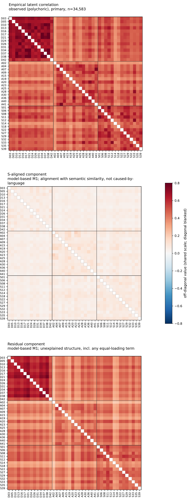

# Semantic null for self-report psychometrics: code

[](LICENSE)
[](requirements-model.txt)


> Does the *wording* of questionnaire items, represented by sentence-embedding similarity, predict the covariance of item responses beyond scale membership? This repository holds the code for testing that question and for studying what such a model can and cannot identify.

Wording enters a likelihood model of the response covariance as a fixed kernel, and the test is an item-label permutation null that reruns the whole fit. The question is therefore whether the kernel's item correspondence matters, not only whether two similarity matrices correlate.

**Paper:** Mettu, A. (2026). *Item wording and the covariance of self-report items: a shape-alignment test, held-out items and an identification limit*. Working paper, version 1. Zenodo (DOI added on release).


## What I found

Questionnaires ask about overlapping experiences in overlapping words, so I wanted to know: when items correlate, how much of that is the people answering, and how much is just the phrasing?

I put the wording pattern directly into a statistical model of the DASS-42 answers (n = 34,583) and let it compete against the usual structure: a general factor, scale factors, surface features like item length and negation, and an agreement-style term. Then I scrambled which wording belongs to which item 100 times and refit the whole model each time. The real pairing beat all 100 scrambles, for three different text encoders. The wording pattern also predicts held-out items: hide 6 items and it still predicts how they will covary, better than every scramble.

The most important finding is a negative one. From one dataset of this kind you cannot say how *much* of the shared covariance is wording: the wording level trades off exactly against the agreement-style term, so the "share explained by semantics" is not identifiable here. Claims that wording alone explains most questionnaire structure go beyond what this kind of data can show.

What this is not: not a causal claim (items about co-occurring experiences may simply be written alike, and one cross-section cannot tell those apart), not a test of whether these scales measure what they claim to measure, and nothing clinical. Effect sizes are deliberately uncalibrated; the paper explains why.

<p align="center">

<br>
<em>Figure 1 of the working paper: what people answered (top), the part shaped like wording similarity (middle), and what is left over (bottom).</em>
</p>

Details, limits and the full argument are in the paper (citation below).

## Repository layout

| Path | Contents |
|---|---|
| `model/` | Covariance model with a fixed text-similarity kernel, a bifactor residual, a nuisance kernel and a free equal-loading term (`model/m1.py`, `model/kernels.py`) |
| `fit/` | Polychoric correlations and the fitting interface |
| `embed/` | Embedding pipeline (three encoders, all-but-the-top reference correction, nuisance text features); contract in `embed/CONTRACT.md`. `embed/out/` holds embeddings of public-domain item text and of synthetic fixtures |
| `integration/` | Analyses: the item-heldout test (`r3_heldout.py`, `split.py`), the level ridge (`level_sweep.py`, `ridge_invariance_bge.py`), effective n (`neff.py`), descriptive baseline (`m0.py`), DASS-42 driver (`dass42.py`) |
| `scripts/` | Fetch public sources by hash, build item tables and item-level aggregates locally |
| `tests/` | Unit tests, including exact identification counterexamples (`test_c3_exchange.py`, `test_id_redteam.py`) |

## What is not here, and why

The study's results are computed from the DASS-42 response file posted by the Open-Source Psychometrics Project. That file carries no licence, so this repository contains **no response data and no statistic computed from it**. A SHA-256 of the host file and a git object id (SHA-1) of the rebuilt correlation matrix are kept so a rebuild can be checked; no aggregates, fitted outputs, figures or manuscript are included. The code above rebuilds the aggregates and the real-data analyses from a copy you download yourself (`data/README.md`).

Simulation and sampler-calibration code tied to that sample, and tests that check the private frozen outputs (including the permutation-null checker, which records statistics of the real fits), are also left out. `embed/MANIFEST.json` describes the full embedding run of the study, so it also names files not distributed here.

## What a fresh clone reproduces

- The model, the fitting code and the unit tests, including the exact identification counterexamples.
- The embedding inputs: every kernel in `embed/out/` is recomputed from the item text by `embed/pipeline.py`.
- The DASS-42 aggregates and effective n, once you download the response file yourself (`data/README.md`).

The analysis drivers keep the integrity checks of the original frozen runs. `integration/r3_heldout.py check-inputs` verifies the correlation matrix against its git history in the original repository (`smoothing_history`), and a clone of this repository has no such history, so the held-out run stops at that check until you remove it. The fitted outputs, permutation nulls and figures behind the paper are not distributed (see above).

## Design decisions

Code comments cite design decisions by number (D1 to D14b). D14 and D14b are the statistics the paper calls pi_shape and pi_shape_groups. `integration/r3_heldout.py` also hashes the original run's protocol files, which are not in this repository.

## Quickstart

```sh
python3.12 -m venv .venv && .venv/bin/pip install -r requirements-model.txt
.venv/bin/python -m pytest -q --ignore=tests/test_embed_pipeline.py
```

`tests/test_embed_pipeline.py` needs the embedding environment (`embed/requirements.lock.txt`).

## Citation

```bibtex
@misc{mettu2026semanticnull,
  author       = {Mettu, Abhay},
  title        = {Item wording and the covariance of self-report items: a shape-alignment test, held-out items and an identification limit},
  year         = {2026},
  howpublished = {Working paper, version 1},
  note         = {Zenodo (DOI added on release)}
}
```

## Licence

Code: MIT (`LICENSE`). Item text, the VADER lexicon and the embedding models keep their own terms (`NOTICE.md`).
